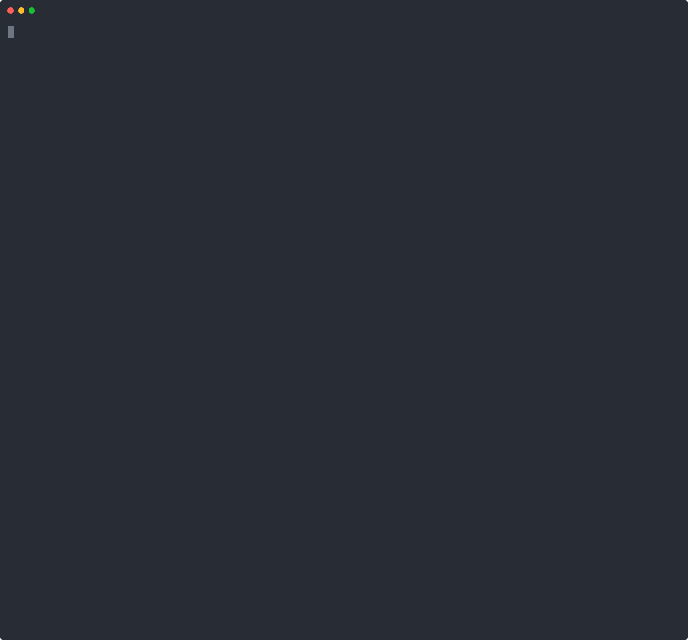

## Table of Contents

- [Install](#install)
  - [From Repos](#installation)
  - [From Source](#build)
- [Dependencies](#dependencies)
- [How it works](#how-it-works)
- [Disclaimer](./disclaimer.md)
- [Thanks](#thanks)

## Demo

[](https://asciinema.org/a/tk9KzxVeL42SZaKQ32i3oQQ58)

## Dependencies

[yt-dlp](https://github.com/yt-dlp/yt-dlp)
[mpv](https://mpv.io/)

## How it works

ani-dl searches [anime-sama](https://anime-sama.to) live: no catalog to download or keep up to date.
Search for an anime, pick a season and a language (VOSTFR, VF...), then watch with mpv or download with yt-dlp.
For each episode, ani-dl tries every player the site offers until one works.

The site changes domain from time to time. ani-dl follows the redirects of its known domains;
if none answers, force the new one:

```bash
ANIME_SAMA_URL=https://anime-sama.new-domain ani-dl
```

The scraper lives in `src/sources/anime_sama.rs` (site pages) and `src/hosts.rs` (video hosts).

## Installation

<details>
  <summary>Arch Linux (AUR)</summary>
  
  ```bash
  yay -S ani-dl
  ```
</details>
<details>
  <summary>Scoop (Windows)</summary>
  
  ```bash
  scoop bucket add extras
  scoop bucket add sendus https://github.com/S3nda/Sendus
  scoop install ani-dl
  ```
</details>
<details>
  <summary>Cargo</summary>
  
  ```bash
  cargo install ani-dl
  ```
</details>

## Build
```bash
git clone https://github.com/B0SEmc/ani-dl.git
cd ani-dl
cargo build --release
```
## Thanks

- [ani-cli](https://github.com/pystardust/ani-cli) for the inspiration and their disclaimer
- [@S3nda](https://github.com/S3nda) for making the original scraper
- [@Tetardtek](https://github.com/Tetardtek) for the first live anime-sama scraper (#28), which this one builds on
